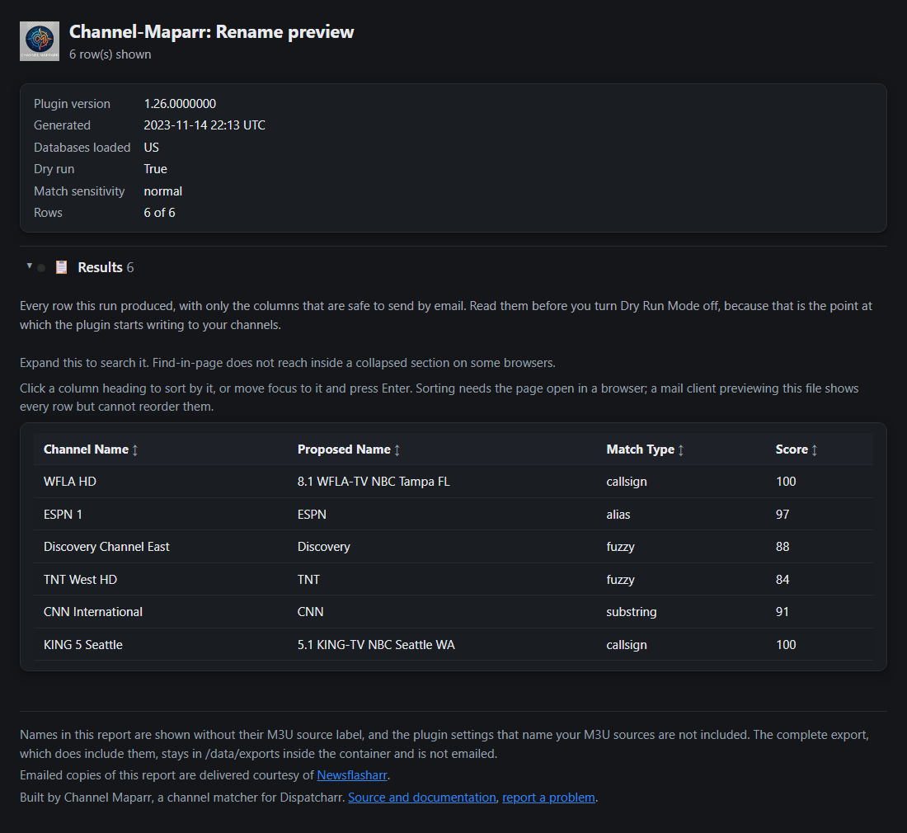

# Channel Mapparr
A Dispatcharr plugin that standardizes broadcast (OTA) and premium/cable channel names using network data and curated channel lists. It reads twelve country databases and can also organise channels into groups, import M3U streams and create channels from streams. 

> [!TIP]
> **New to Dispatcharr plugins?** Start with the **[Dispatcharr Plugin Workflow guide](https://piratesirc.github.io/Dispatcharr-Plugin-Workflow/)**.
> It explains what each plugin and tool does, where they overlap, and what order to use them in.

## What it does

**Naming**
* **Broadcast (OTA) station matching** for United States local affiliates, by callsign, against a bundled 6,839-station table built from the Federal Communications Commission licensing database. `ABC 5 (WEWS) CLEVELAND HD` becomes `ABC - OH Cleveland (WEWS)`. Subchannels resolve to their own network, and callsigns that are also ordinary English words are handled without false positives.
* **Customizable name format** using `{NETWORK}`, `{STATE}`, `{CITY}` and `{CALLSIGN}`.
* **Curated channel databases** for 12 countries, about 42,900 channels: AU, BR, CA, DE, ES, FR, IN, MX, NL, NO, UK, US.
* **Suffix for unmatched channels**, so what did not match is easy to find later.

**Matching**
* **A four-stage pipeline**: a 200-entry alias map, then exact, then substring, then fuzzy token matching. The alias stage resolves common variants such as `FNC` to `Fox News Channel` without any scoring.
* **Four sensitivity presets**, from Relaxed to Exact.
* **False-positive guards** that stop `BBC One` matching `BBC Two`, `ESPN 1` matching `ESPN 2`, and `ABC News` matching `BBC News`.
* **Provider-junk normalization**: stylized Unicode, emoji used as letters, resolution markers, bouquet tags and country prefixes are all removed before matching. Plain ASCII names are left untouched.
* **Non-Latin script support**: Cyrillic, CJK and Arabic names are preserved rather than reduced to nothing.
* **Fast**: token-based pre-filtering matches 19,000 streams against 31,000 channels in seconds.

**Organizing**
* **Category-based grouping**: move channels into groups by content category.
* **M3U stream import**: create channels from streams, organized by category, in the background.
* **Scoping**: process only named groups, or exclude groups with wildcard patterns. A pattern matching nothing refuses the run rather than silently processing everything.
* **Logos**: one default logo in bulk, or per-channel artwork fuzzy-matched against the [tv-logo/tv-logos](https://github.com/tv-logo/tv-logos) repository.

**Seeing what happened**
* **Dry Run Mode**: every mutating action writes a CSV of what it would have done, and changes nothing.
* **Show Status**: live progress and estimated time for the running or most recent operation.
* **Emailed reports**: optionally email each run as an HTML page and/or a CSV, delivered by the [Newsflasharr](https://github.com/PiratesIRC/Dispatcharr-Newsflasharr-Plugin) plugin. Off by default. **The emailed report never contains your M3U source names**, which the CSV exports do carry in their settings header, and channel names are also scrubbed of M3U account names and IP addresses. The HTML page opens as an index with its table in a collapsed section, and sorts by clicking a column heading. Newsflasharr's own Show Status action shows how many reports this plugin has built.

See the **[user guide](docs/USER-GUIDE.md)** for how to use these, and for every setting.

### The emailed report

The page opens as an index: the logo beside the title, a summary card of the run, then one section
headed **Results** carrying its row count, which starts collapsed.

Click that heading and the table appears.

*Sample data, shown here in dark mode; the page follows whichever theme your reader uses. Click any
column heading to sort by it; numeric columns are compared as numbers, so channel 18 sorts before 31
rather than after 102. The plugin settings that name your M3U sources are deliberately absent from
this page.*

## Requirements
* Dispatcharr v0.20.0+
* Internet access, only for **Apply Per-Channel Logos (tv-logos)**, which fetches the logo file list from GitHub. The anonymous usage counts report (see below) also needs it, and it never blocks a run. Every other action works without it. The plugin no longer checks for its own updates.
* The [Newsflasharr](https://github.com/PiratesIRC/Dispatcharr-Newsflasharr-Plugin) plugin, only if you want **emailed reports**. It is what actually sends the mail. Channel Mapparr does not require it: with Newsflasharr absent or disabled, nothing is sent and nothing fails.

## Installation
1. Log in to Dispatcharr's web UI.
2. Navigate to **Plugins**.
3. Click **Import Plugin** and upload the plugin zip file.
4. Enable the plugin after installation.

Upgrading from an earlier version has its own short procedure: see
[Updating the plugin](docs/USER-GUIDE.md#updating-the-plugin).

## Anonymous usage counts

The Channels Renamed and Active Installs badges count every install that leaves the "Share anonymous usage counts" setting (on by default) ticked and runs at least one action. Channels Renamed counts one for each channel whose name this plugin changes, by either Rename Channels or Tag Unknown Channels. A channel renamed again later, by either action, counts again. A run that changes no name counts nothing, and a preview or a Dry Run counts nothing. Organize by Category, the logo actions, Import M3U Streams and Create Channels From Streams are not counted. A rename you later undo by hand still counts, because the count is of renames made, not of channels that carry a changed name today. The count starts at zero on every install. There is no earlier record, so renames made before this version are not counted.

When an action finishes, the plugin sends this plugin's Channels Renamed total and a random id for this plugin on this install to the plugin author's counter at plugin-stats.dpas.workers.dev. It sends at most once an hour after a successful send, or ten minutes after the last successful send when a run has just renamed channels. There is no timer: a run that finishes inside the gap sends nothing, and the next action that finds the gap passed sends the total.

The server stores that id with the total and the date of the last report, and keeps them until this install unticks the setting and the delete succeeds, or until the plugin author removes them by hand. An install that stops reporting still counts toward Channels Renamed. The connection shows the server your public IP address; the server uses it only to limit abuse and does not store it in its database, though when an install first registers it keeps a salted one-way hash of it (of its /64 block for IPv6) for up to three days. Cloudflare, which hosts the server, keeps its own request logs. No channel names, group names, URLs, providers or settings are sent. The figures are self-reported by installs and capped by the server, not verified.

What counts as an active install: an install that sent at least one report in the last 30 UTC days. A badge changes after the server's hourly recount, which runs at the start of each UTC hour, and Shields may cache the badge for up to an hour more, so a new report can take up to about two hours to show.

The setting is the last one in the settings form, in its own section. Unticking it takes effect when the next action finishes; the plugin then asks the server to delete this install's figures. Once the server confirms the delete, the plugin forgets its id, and ticking the setting again later starts a new one; if the delete could not reach the server, the plugin keeps the id and retries. The plugin keeps that id and the timing of its reports in /data/plugin_stats/channel-mapparr/ (install_id, sent, backoff, disabled, delete_backoff, lock). To start a new id, untick the setting and let an action run so the server deletes this install's figures; deleting that folder while the setting is ticked, or before the server confirms the delete, leaves the old figures on the server, and the new id then sends the full total again, so the badge counts it twice.

## Documentation

| Document | What it covers |
| :--- | :--- |
| **[User guide](docs/USER-GUIDE.md)** | Step-by-step walkthroughs: a first run, scoping which channels are touched, how OTA names are built, and setting up emailed reports end to end. |
| **[Changelog](docs/CHANGELOG.md)** | What changed between versions, and why. |
| **[Development notes](docs/DEVELOPMENT.md)** | How the plugin is put together and how to run the tests. |
| **[Open work](docs/TODO.md)** | Known gaps and planned improvements. |

## Disclaimer

**Channel Mapparr provides no television content of any kind.** It supplies no channels, no
playlists, no streams, no electronic programme guide data and no provider accounts, and it
contains no list of where to obtain any of those. It renames and organizes channel entries that
already exist in **your** Dispatcharr installation, matching them against bundled reference data:
curated per-country channel lists and a table of United States broadcast station callsigns
published by the Federal Communications Commission.

The plugin never contacts a media provider. It never opens, fetches, decodes, records, restreams
or redistributes any stream. It reads stream *names* to match them, and never the streams
themselves. The outbound connections it makes are to GitHub, only when you run **Apply Per-Channel Logos**, which fetches a public list of logo filenames, and a small usage report at most once an hour (ten minutes after the last successful send when a run has just renamed channels), which you can turn off (see [Anonymous usage counts](#anonymous-usage-counts)). Emailed reports, if you enable
them, are handed to the Newsflasharr plugin, which sends them to destinations **you** configured.

**You are responsible for what you connect Dispatcharr to.** Whether a particular provider,
subscription, playlist or stream is lawful for you to use depends on your agreement with that
provider and on the law where you live. Use only sources you are authorised to use. Nothing in this
project is intended to enable, encourage or assist access to content you have no right to access.

All product names, channel names, network names, callsigns, trademarks and registered trademarks
mentioned in this project or appearing in its examples or bundled reference data are the property
of their respective owners. This project is an independent, community-built plugin. It is not
affiliated with, endorsed by, or sponsored by any television network, broadcaster, streaming
service or IPTV provider, and it is not affiliated with the Dispatcharr project beyond being a
plugin written for it.

## License
This plugin integrates with Dispatcharr's plugin system and follows its licensing terms.
